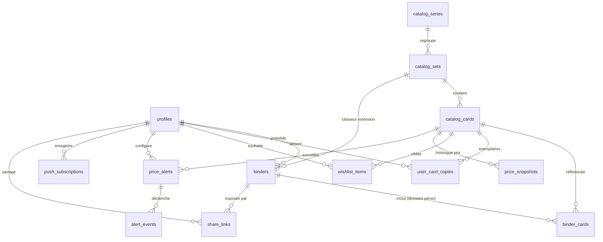

# 02 — Modèle de données (PostgreSQL / Supabase self-host)

> Toutes les tables applicatives vivent dans le schéma `public` avec **Row Level Security (RLS)** activée par défaut et migrations versionnées dans `supabase/migrations/`.

---

## 1. Vue d’ensemble (ERD)

---

## 2. Catalogue Pokémon (données partagées en lecture seule)

Synchronisé depuis **TCGdex** par un job serveur (jamais modifié par les utilisateurs finaux).

### `catalog_series`
| Colonne | Type | Contraintes / Notes |
|---|---|---|
| `id` | `text` | PK (`sv`, `swsh`, `sm`, `xy`, `base`…) |
| `name_fr` | `text` | NOT NULL (`Écarlate et Violet`) |
| `name_en` | `text` | Nullable |
| `release_order` | `integer` | Ordre chronologique décroissant/croissant |
| `updated_at` | `timestamptz` | NOT NULL DEFAULT `now()` |

### `catalog_sets`
| Colonne | Type | Contraintes / Notes |
|---|---|---|
| `id` | `text` | PK (`sv03.5`, `sv08`, `sv08.5`…) |
| `series_id` | `text` | FK → `catalog_series(id)` |
| `code` | `text` | Code court affiché (`EV3.5`, `EV08`, `PRE`, `MEW`) |
| `cardmarket_code` | `text` | Code set pour export CSV Cardmarket (`MEW`, `SSP`, `PRE`) |
| `name_fr` | `text` | NOT NULL (`151`, `Étincelles Déferlantes`) |
| `name_en` | `text` | Nullable |
| `logo_url` | `text` | URL logo officiel FR TCGdex |
| `symbol_url` | `text` | URL symbole officiel TCGdex |
| `release_date` | `date` | Date de sortie officielle |
| `official_count` | `integer` | Nombre officiel (ex. `165`) |
| `total_count` | `integer` | Total secrètes incluses (ex. `207`) |
| `updated_at` | `timestamptz` | NOT NULL DEFAULT `now()` |

### `catalog_cards`
| Colonne | Type | Contraintes / Notes |
|---|---|---|
| `id` | `text` | PK TCGdex (`sv03.5-199`) |
| `set_id` | `text` | FK → `catalog_sets(id)`, indexé |
| `local_id` | `text` | Numéro sur la carte (`199`, `025`, `TG01`), indexé |
| `local_id_numeric` | `integer` | Partie numérique pour tri naturel + saisie pavé `#` |
| `name_fr` | `text` | NOT NULL (`Dracaufeu-ex`) |
| `name_en` | `text` | Nullable (`Charizard ex`) |
| `rarity` | `text` | Rareté normalisée (`SIR`, `AR`, `UR`, `DR`, `Holo`, `Common`…) |
| `holo_effect` | `text` | Preset 3D dérivé (`none`, `holo`, `reverse`, `ex`, `sir`, `tera`, `gold`) |
| `category` | `text` | `Pokemon`, `Trainer`, `Energy` |
| `types` | `text[]` | `['Fire']`, etc. |
| `hp` | `integer` | Nullable (`330`) |
| `illustrator` | `text` | Nullable (`miki kudo`) |
| `image_base_url` | `text` | Base TCGdex (`https://assets.tcgdex.net/fr/sv/sv03.5/199`) |
| `available_variants` | `text[]` | `['normal', 'reverse', 'holo', 'promo']` |
| `cardmarket_product_id` | `integer` | Nullable — identifiant Cardmarket pour scraping direct & lien externe |
| `cardmarket_url` | `text` | URL fiche Cardmarket |
| `search_vector` | `tsvector` | Colonne générée indexée GIN (`name_fr`, `name_en`, `local_id`, `illustrator`) |
| `updated_at` | `timestamptz` | NOT NULL DEFAULT `now()` |

---

## 3. Utilisateurs, Classeurs & Collection

### `profiles`
| Colonne | Type | Contraintes / Notes |
|---|---|---|
| `id` | `uuid` | PK, FK → `auth.users(id) ON DELETE CASCADE` |
| `display_name` | `text` | NOT NULL (affiché dans le profil & partages publics) |
| `avatar_initials` | `text` | 2 lettres par défaut (`EN`) |
| `locale` | `text` | NOT NULL DEFAULT `'fr'` |
| `currency` | `text` | NOT NULL DEFAULT `'EUR'` |
| `theme` | `text` | `'system' \| 'dark' \| 'light'` DEFAULT `'dark'` |
| `default_card_lang` | `text` | `'FR' \| 'EN' \| 'JP' \| 'ZH'` DEFAULT `'FR'` |
| `default_card_condition` | `text` | `'M' \| 'NM' \| 'EX' \| 'GD' \| 'LP' \| 'PL' \| 'PO'` DEFAULT `'NM'` |
| `discord_user_id` | `text` | Nullable (rempli lors de la liaison OAuth Discord) |
| `discord_webhook_url` | `text` | Nullable (option webhook perso chiffré / protégé RLS) |
| `push_enabled` | `boolean` | NOT NULL DEFAULT `false` |
| `discord_alerts_enabled` | `boolean` | NOT NULL DEFAULT `false` |
| `created_at` | `timestamptz` | NOT NULL DEFAULT `now()` |
| `updated_at` | `timestamptz` | NOT NULL DEFAULT `now()` |

### `binders` (Classeurs : extensions suivies + dossiers perso)
| Colonne | Type | Contraintes / Notes |
|---|---|---|
| `id` | `uuid` | PK DEFAULT `gen_random_uuid()` |
| `user_id` | `uuid` | FK → `profiles(id) ON DELETE CASCADE`, indexé |
| `kind` | `text` | NOT NULL CHECK (`kind IN ('set', 'custom')`) |
| `set_id` | `text` | FK → `catalog_sets(id)`, NOT NULL si `kind = 'set'`, UNIQUE `(user_id, set_id)` |
| `title` | `text` | NOT NULL |
| `cover_type` | `text` | NOT NULL CHECK (`cover_type IN ('set_logo', 'card', 'upload')`) DEFAULT `'set_logo'` |
| `cover_card_id` | `text` | FK → `catalog_cards(id)` (si `cover_type = 'card'`) |
| `cover_storage_path` | `text` | Chemin Supabase Storage bucket `binder-covers` (si `cover_type = 'upload'`) |
| `is_pinned` | `boolean` | NOT NULL DEFAULT `false` |
| `sort_order` | `integer` | NOT NULL DEFAULT `0` |
| `created_at` | `timestamptz` | NOT NULL DEFAULT `now()` |
| `updated_at` | `timestamptz` | NOT NULL DEFAULT `now()` |

### `binder_cards` (uniquement pour les `binders` de type `'custom'`)
| Colonne | Type | Contraintes / Notes |
|---|---|---|
| `binder_id` | `uuid` | FK → `binders(id) ON DELETE CASCADE` |
| `card_id` | `text` | FK → `catalog_cards(id)` |
| `position` | `integer` | Ordre libre dans le dossier perso |
| `added_at` | `timestamptz` | NOT NULL DEFAULT `now()` |
| — | PK | `(binder_id, card_id)` |

### `user_card_copies` (exemplaires possédés)
| Colonne | Type | Contraintes / Notes |
|---|---|---|
| `id` | `uuid` | PK DEFAULT `gen_random_uuid()` |
| `user_id` | `uuid` | FK → `profiles(id) ON DELETE CASCADE`, indexé |
| `card_id` | `text` | FK → `catalog_cards(id)`, indexé |
| `language` | `text` | NOT NULL CHECK (`IN ('FR','EN','JP','ZH')`) DEFAULT `'FR'` |
| `variant` | `text` | NOT NULL CHECK (`IN ('normal','reverse','holo','promo','pokeball','masterball')`) |
| `condition` | `text` | NOT NULL CHECK (`IN ('M','NM','EX','GD','LP','PL','PO')`) DEFAULT `'NM'` |
| `quantity` | `integer` | NOT NULL CHECK (`quantity > 0`) DEFAULT `1` |
| `purchase_price_cents` | `integer` | Nullable — **strictement privé**, jamais exposé en partage public |
| `grading_company` | `text` | Nullable (`PSA`, `PCA`, `BGS`, `CGC`) |
| `grading_score` | `text` | Nullable (`10`, `9.5`) |
| `notes` | `text` | Nullable — **strictement privé** |
| `acquired_at` | `date` | Nullable DEFAULT `current_date` |
| `created_at` | `timestamptz` | NOT NULL DEFAULT `now()` |
| `updated_at` | `timestamptz` | NOT NULL DEFAULT `now()` |
| — | UNIQUE | `(user_id, card_id, language, variant, condition, coalesce(grading_company,''), coalesce(grading_score,''))` |

---

## 4. Prix Cardmarket, Wishlist, Alertes & Partage

### `price_snapshots` (cache TTL + historique léger)
| Colonne | Type | Contraintes / Notes |
|---|---|---|
| `id` | `bigserial` | PK |
| `card_id` | `text` | FK → `catalog_cards(id)`, indexé |
| `language` | `text` | `'FR' \| 'EN' \| 'JP'` DEFAULT `'FR'` |
| `variant` | `text` | `'normal' \| 'reverse' \| 'holo'` DEFAULT `'normal'` |
| `source` | `text` | `'cardmarket' \| 'tcgdex_fallback'` |
| `trend_cents` | `integer` | Prix tendance en centimes EUR |
| `low_fr_cents` | `integer` | Plus bas FR (NM+) en centimes EUR |
| `avg30_cents` | `integer` | Moyenne 30 jours en centimes EUR |
| `fetched_at` | `timestamptz` | NOT NULL DEFAULT `now()` (sert au calcul de fraîcheur TTL 15 min) |
| `expires_at` | `timestamptz` | NOT NULL (`fetched_at + interval '15 minutes'`) |

> Une vue ou table matérialisée légère `card_latest_prices` (ou `DISTINCT ON (card_id, language, variant)`) accélère les lectures grilles et dashboards.

### `wishlist_items`
| Colonne | Type | Contraintes / Notes |
|---|---|---|
| `id` | `uuid` | PK DEFAULT `gen_random_uuid()` |
| `user_id` | `uuid` | FK → `profiles(id) ON DELETE CASCADE` |
| `card_id` | `text` | FK → `catalog_cards(id)` |
| `language` | `text` | NOT NULL DEFAULT `'FR'` |
| `variant` | `text` | NOT NULL DEFAULT `'normal'` |
| `min_condition` | `text` | NOT NULL DEFAULT `'NM'` |
| `priority` | `text` | NOT NULL CHECK (`IN ('normal','high')`) DEFAULT `'normal'` |
| `target_price_cents` | `integer` | Nullable |
| `created_at` | `timestamptz` | NOT NULL DEFAULT `now()` |
| — | UNIQUE | `(user_id, card_id, language, variant)` |

### `price_alerts` & `alert_events`
- **`price_alerts`** : `id`, `user_id`, `card_id`, `language`, `min_condition`, `price_field` (`'low_fr' | 'trend'`), `threshold_cents`, `is_active` (`boolean`), `notify_push` (`boolean`), `notify_discord` (`boolean`), `cooldown_hours` (`integer` DEFAULT `24`), `last_triggered_at` (`timestamptz`), `created_at`, `updated_at`.
- **`alert_events`** : `id`, `alert_id` (FK `price_alerts`), `user_id`, `observed_price_cents`, `threshold_cents`, `channels_sent` (`text[]`), `read_at` (`timestamptz` — pilote la pastille verte sur la Navbar B), `triggered_at` (`timestamptz`).

### `push_subscriptions`
- `id`, `user_id`, `endpoint` (UNIQUE), `p256dh`, `auth`, `user_agent`, `created_at`, `last_seen_at`.

### `share_links`
| Colonne | Type | Contraintes / Notes |
|---|---|---|
| `id` | `uuid` | PK DEFAULT `gen_random_uuid()` |
| `user_id` | `uuid` | FK → `profiles(id) ON DELETE CASCADE` |
| `binder_id` | `uuid` | FK → `binders(id) ON DELETE CASCADE` |
| `token` | `text` | UNIQUE NOT NULL (32 octets aléatoires encodés base64url, non devinable) |
| `is_active` | `boolean` | NOT NULL DEFAULT `true` |
| `show_quantities` | `boolean` | NOT NULL DEFAULT `true` (permet de montrer les doublons) |
| `created_at` | `timestamptz` | NOT NULL DEFAULT `now()` |
| `revoked_at` | `timestamptz` | Nullable |

---

## 5. Politiques RLS (Row Level Security) & Index critiques

### Règles RLS
1. **Catalogue (`catalog_*`, `price_snapshots`)** : `SELECT` ouvert aux utilisateurs authentifiés (et au rôle serveur pour les vues publiques) ; écriture strictement réservée au `service_role` (worker / sync).
2. **Tables personnelles (`profiles`, `binders`, `binder_cards`, `user_card_copies`, `wishlist_items`, `price_alerts`, `alert_events`, `push_subscriptions`, `share_links`)** :
   - `USING (auth.uid() = user_id)` et `WITH CHECK (auth.uid() = user_id)`.
3. **Accès public partagé (`/s/:token`)** :
   - Jamais d’ouverture `SELECT` globale sur `user_card_copies` ou `profiles` pour `anon`.
   - Exposition exclusive via une **fonction SQL `SECURITY DEFINER`** (`get_shared_binder(p_token text)`) qui vérifie `is_active = true AND revoked_at IS NULL` et retourne **uniquement** : `display_name`, infos du classeur, et `(card_id, language, variant, quantity)` — zéro email, zéro `purchase_price_cents`, zéro `notes`.

### Index essentiels
- `catalog_cards(set_id, local_id_numeric)` — ouverture instantanée d’une grille classeur et saisie au pavé `#`.
- `catalog_cards USING GIN (search_vector)` + `pg_trgm` sur `name_fr` — recherche tolérante aux fautes de frappe (`"Dracau"` → *Dracaufeu-ex*).
- `user_card_copies(user_id, card_id)` — agrégation rapide complétion & doublons.
- `price_snapshots(card_id, language, variant, fetched_at DESC)` — lookup O(1) du dernier prix et contrôle TTL.
- `price_alerts(is_active, card_id)` — sélection rapide des alertes à évaluer par le cron.
