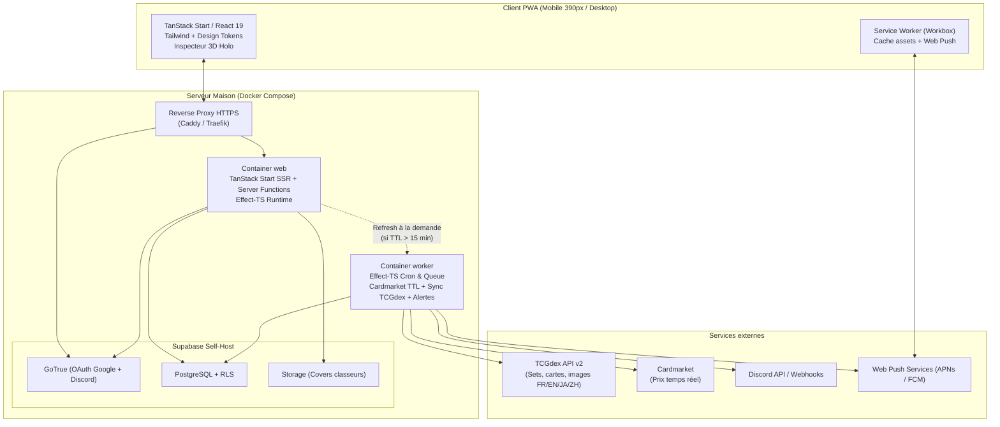

# 03 — Architecture technique & Design System

> Stack cible : **TanStack Start** (React 19, SSR, PWA) + **Effect-TS** (logique métier & worker) + **Supabase self-host** (Postgres, Auth, Storage) — le tout packagé en **Docker Compose** (100 % gratuit et auto-hébergeable).

---

## 1. Architecture système globale



---

## 2. Organisation du dépôt (monorepo léger / modules propres)

Un dépôt unique avec frontières claires entre le **domaine pur (Effect-TS)**, le **front/SSR (TanStack Start)** et le **worker** :

```text
pokecardex/
├── docs/                          # Documentation 00 à 08 + design-brief.md
├── AGENTS.md                      # Règles projet & conventions pour humains et IA
├── docker-compose.yml             # Stack self-host complète (web + worker + Supabase)
├── Dockerfile                     # Multi-stage build (cibles: web, worker)
├── supabase/
│   └── migrations/                # Migrations SQL versionnées & RLS
├── packages/
│   ├── domain/                    # Modèles Effect.Schema, erreurs typées, calculs purs
│   │   ├── card.ts                # Cartes, variantes, ratios, mapping effet 3D
│   │   ├── collection.ts          # Calculs complétion, valeur, batch saisie rafale
│   │   ├── cardmarket.ts          # Format CSV / Add Card List, fraîcheur TTL
│   │   └── alerts.ts              # Moteur pur d'évaluation de seuils + cooldown
│   └── services/                  # Services Effect-TS (Layers injectables & testables)
│       ├── db.ts                  # Client Postgres typé (Kysely / Drizzle + Effect)
│       ├── tcgdex.ts              # Client TCGdex avec Retry + Schedule
│       ├── cardmarket.ts          # Scraper + RateLimiter + CircuitBreaker
│       └── notifications.ts       # Push Web (VAPID) + Discord DM/Webhook
├── apps/
│   ├── web/                       # TanStack Start (routes, Server Functions, PWA, UI)
│   │   ├── src/
│   │   │   ├── routes/            # /, /collection, /binder/$id, /search, /wishlist, /alerts, /s/$token
│   │   │   ├── components/        # UI atomique + Navbar B + CardTile + Viewer3D + Sheets
│   │   │   ├── styles/tokens.css  # Tokens Dark & Light exacts issus de Brilliant
│   │   │   └── i18n/              # Dictionnaires fr.ts (+ en.ts prêt)
│   └── worker/                    # Processus dédié Effect-TS (cron prix, sync sets, alertes)
└── .github/
    ├── workflows/                 # ci.yml (PR), cd.yml (main -> GHCR)
    ├── PULL_REQUEST_TEMPLATE.md
    └── ISSUE_TEMPLATE/
```

---

## 3. Rôle d’Effect-TS (architecture propre et testable)

Toute la logique métier non triviale passe par des **Services Effect-TS** consommés aussi bien par les *Server Functions* de TanStack Start que par le container `worker` :

- **Validation aux frontières** : `Effect.Schema` pour chaque payload entrant (actions utilisateur, saisie rafale en lot, réponses TCGdex, résultats Cardmarket, paramètres d’alerte).
- **Erreurs typées explicites** (`Data.TaggedError`) : `CardmarketRateLimited`, `CardmarketUnavailable`, `UnauthorizedBinderAccess`, `ShareTokenRevoked`, `ValidationError` — zéro exception silencieuse.
- **Résilience intégrée** : `Schedule.exponential` + jitter sur TCGdex/Cardmarket, `Semaphore` pour limiter la concurrence scraping, `Ref` / Redis-free in-process rate limiter + verrou Postgres (`pg_advisory_lock`) si plusieurs jobs s’exécutent.
- **Testabilité** : en test unitaire Vitest, on injecte des *Test Layers* (faux client Cardmarket, faux notificateur Discord, horloge `TestClock`) sans toucher au réseau.

---

## 4. Design System & Tokens (alignés 1:1 sur Brilliant)

Les tokens validés sur les maquettes Dark & Light sont centralisés en variables CSS (`styles/tokens.css`) et consommés par Tailwind :

| Rôle | Dark Mode | Light Mode | Usage |
|---|---|---|---|
| `--bg-canvas` | `#0B0D12` | `#F4F6FA` | Fond d’écran principal |
| `--bg-surface-1` | `#121620` | `#FFFFFF` | Cartes, classeurs, lignes de liste |
| `--bg-surface-2` | `#181D2A` | `#EEF2F9` | Fonds d’icônes, hover, pistes secondaires |
| `--border-subtle` | `rgba(255,255,255,0.08)` | `rgba(15,23,42,0.08)` | Bordures fines `1px` |
| `--text-primary` | `#F4F6FA` | `#0F172A` | Titres, valeurs, libellés actifs |
| `--text-secondary` | `#94A0B8` | `#475569` | Sous-titres, métadonnées |
| `--text-muted` | `#5E6A82` | `#64748B` | Mentions discrètes, horodatages |
| `--accent-gold` | `#F5C43D` | `#A16207` *(texte)* / `#E5AC1A` *(barres)* | CTA principaux, actif Navbar B, complétion |
| `--accent-gold-soft` | `rgba(245,196,61,0.15)` | `#FEF6DA` | Fond pilule active, badges prio |
| `--accent-blue` | `#60A5FA` | `#2563EB` | Filtres actifs, liens, wishlist, partages |
| `--semantic-success` | `#22C55E` / `#4ADE80` | `#16A34A` / `#15803D` | Fraîcheur prix, seuils atteints, nouvelles cartes |
| `--semantic-warning` | `#F59E0B` | `#D97706` | Prix à rafraîchir (> 15 min) |
| `--semantic-danger` | `#EF4444` | `#DC2626` | Hausse forte, déconnexion, suppression |

### Typographie & Géométrie
- **UI & Titres** : `Plus Jakarta Sans` (fallback `Inter`, `system-ui`).
- **Chiffres & Codes** : `JetBrains Mono` avec `font-variant-numeric: tabular-nums` (prix `3 482,50 €`, numéros `#199/165`, pourcentages `69 %`).
- **Cartes Pokémon** : `aspect-ratio: 63 / 88`, coins `6px–8px` en grille, `16px` en Inspecteur 3D.
- **Composants clés partagés** : `FloatingPillNavbar` (Navbar B), `CardTile` (états possédée / doublon / manquante / rafale), `BinderCard` (cover unique : logo / carte / upload), `BottomSheet` (filtres, fiche carte, export CSV, création alerte), `HoloCardViewer3D`.

---

## 5. Déploiement Docker Compose tout-en-un (100 % gratuit)

- **Développement local** : `supabase start` (ou `docker compose -f docker-compose.dev.yml up`) + `pnpm dev` avec HMR.
- **Production self-host** :
  - Un `docker-compose.yml` unique contenant : `caddy` (HTTPS auto Let’s Encrypt ou certificat local), `web`, `worker`, et la stack `supabase` self-host (Postgres, GoTrue, Storage, PostgREST si besoin).
  - Images `web` et `worker` publiées gratuitement sur **GHCR (`ghcr.io/<user>/pokevault`)** par GitHub Actions.
  - Endpoint `/api/health` vérifiant la connexion Postgres + fraîcheur du dernier tick du worker.
